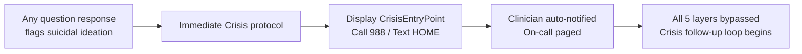

# Escalation Flow Diagrams — 5 Progressive Disclosure Layers

**Document Type:** UX Flow Specification
**Status:** Final
**Issue:** FIR-86
**Designer:** UX Designer
**Date:** 2026-07-07

---

## Overview

The escalation system uses 5 progressive disclosure layers to move from **ambient awareness** to **clinician escalation**. Each layer adds information density and actionability. The user never jumps from zero to full clinical data — they opt in at each step.

### Layer Map

| # | Layer | Trigger | UX Surface | User Effort | Escalation Depth |
|---|-------|---------|------------|-------------|------------------|
| 1 | Ambient Awareness | Pattern detected (engine) | Passive indicator in dashboard | Zero (passive) | None |
| 2 | Contextual Nudge | 2+ days concerning pattern | Inline card in check-in flow | 1 tap to dismiss | Awareness |
| 3 | Guided Reflection | Nudge accepted / 3+ days | Full-screen mini-assessment | 3 questions | Assessment |
| 4 | Warm Referral | Score threshold crossed | Provider cards + CTA | 1 tap to request | Connection |
| 5 | Clinician Escalation | User consent + high score | Consent flow + dashboard alert | Explicit opt-in | Clinical |

### Flow Entry Points

- **Check-in completion** (default): After daily check-in, if engine detects a pattern
- **Dashboard passive** (Layer 1 only): Ambient indicator always visible
- **"Get Support" from dashboard** (bypass Layers 1-2, enter at Layer 3)
- **Persistent footer** (bypass all, enter crisis flow at Layer 5)
- **Push notification** (direct to Layer 2 or Layer 3 depending on severity)

---

## Layer 1: Ambient Awareness

### Purpose
Give the user a subtle, non-alarming signal that the app has noticed something. No action required. No interruption.

### Trigger Condition
```
escalation_engine.score >= 1 (on a 0-5 scale)
  AND pattern_duration >= 1 day
```

### Flow Diagram

```mermaid
flowchart TD
    A[Daily check-in complete] --> B{Escalation engine<br/>computes score}
    B -->|score < 1| C[Dashboard: "You're doing great"<br/>No indicator]
    B -->|score >= 1<br/>pattern >= 1d| D[Dashboard: Ambient dot appears<br/>next to check-in card]
    
    D --> E{Does user tap<br/>the dot?}
    E -->|No| F[Dot persists, passive<br/>No push notification<br/>No interruption]
    E -->|Yes| G[Tooltip opens:<br/>"We're noticing a pattern —<br/>no action needed right now"]
    
    G --> H{Next check-in<br/>completes}
    H -->|Pattern resolved| I[Dot disappears<br/>"You're doing well."]
    H -->|Pattern continues<br/>2+ days| J[Auto-advance to Layer 2<br/>on next check-in]
```

### Decision Matrix

| Condition | Layer 1 Visible? | Next Action |
|-----------|-----------------|-------------|
| No pattern detected | No | — |
| 1 day, low score | Yes, muted dot | Wait for next check-in |
| 1 day, high score | Yes, standard dot | Advance to Layer 2 on next check-in |
| User tapped dot+closed | Yes, persists | Same as above |
| User tapped dot+dismissed tooltip | Yes, persists | Tooltip suppressed 24h |
| Pattern resolved | No | Clear indicator |

### Visual Spec

```
┌──────────────────────────────────────────┐
│  Your Daily Check-In                      │
│                                           │
│  You're all caught up for today!          │
│                                           │
│  ┌──────┐                                 │
│  │ ●    │  Next check-in: Tomorrow 10 AM  │
│  └──────┘                                 │
│    ▲                                       │
│    └─ Ambient dot: 8px, warm-400          │
│       Acts like a notification dot        │
│       No animation (no pulse)             │
│       Tappable → tooltip                  │
│                                            │
│  [Check in now]                           │
└──────────────────────────────────────────┘
```

---

## Layer 2: Contextual Nudge

### Purpose
Gently bring the pattern to the user's attention with a specific observation and an open door. Example: "You've had 5 nights of disrupted sleep. Want to talk about it?"

### Trigger Condition
```
escalation_engine.score >= 2
  AND (pattern_duration >= 2 days OR consecutive_flag >= 2)
```

### Flow Diagram

```mermaid
flowchart TD
    A[Check-in notification<br/>or user opens app] --> B{Check nudge state}
    B -->|No active nudge| C[Normal check-in flow]
    B -->|Active nudge pending| D[Check: was nudge<br/>dismissed in last 24h?]
    
    D -->|Yes, suppressed| C
    D -->|No| E[Display nudge card<br/>after check-in completion]
    
    E --> F[Inline nudge card:<br/>"We've noticed [X].<br/>Want to talk about it?"]
    
    F --> G{User response}
    G -->|Dismiss "Not now"| H[Log dismiss<br/>Suppress 24h<br/>Return to dashboard]
    G -->|Tap "Talk about it"| I[Advance to Layer 3<br/>Guided Reflection]
    G -->|Ignore (swipe away)| J[Log passive dismiss<br/>Re-appear next check-in]
    
    H --> K{3+ dismissals<br/>in 7 days?}
    K -->|No| L[Wait for next check-in]
    K -->|Yes| M[Escalate to Layer 3<br/>on next check-in<br/>regardless of dismiss]
```

### Nudge Copy Variants

| Pattern | Nudge Copy |
|---------|-----------|
| Sleep disruption (3+ nights <4h) | "You've had 5 nights of disrupted sleep. Want to talk about it?" |
| Low mood (2+ days below baseline) | "The last few days have felt tougher. Want to check in?" |
| Physical recovery concern | "Your recovery seems a bit slower than expected. We're here." |
| Combined (sleep + mood) | "This week has been harder. Let's check in together?" |

### Visual Spec

```
┌──────────────────────────────────────────────┐
│  Check-in complete ✓                          │
│                                               │
│  ┌────────────────────────────────────────┐   │
│  │ ☀️  We've noticed a pattern             │   │
│  │                                         │   │
│  │  You've had 5 nights of disrupted       │   │
│  │  sleep. That's really tough —           │   │
│  │  especially with a new baby.            │   │
│  │                                         │   │
│  │  Would it help to talk through it?      │   │
│  │                                         │   │
│  │  ┌────────────────────────────┐        │   │
│  │  │  Yes, let's talk about it  │        │   │
│  │  └────────────────────────────┘        │   │
│  │                                         │   │
│  │  Not right now                          │   │  ghost link
│  └────────────────────────────────────────┘   │
│                                                │
│  [Back to dashboard]                           │
└────────────────────────────────────────────────┘
```

---

## Layer 3: Guided Reflection

### Purpose
A structured 3-question mini-assessment to gather enough data to determine the right support path. Not a diagnosis — a conversation.

### Trigger Condition
```
User accepts nudge (Layer 2 → Layer 3)
  OR escalation_engine.score >= 3
  OR 3+ nudge dismissals in 7 days
  OR user taps "Get Support" from dashboard
```

### Flow Diagram

```mermaid
flowchart TD
    A[Enter Guided Reflection] --> B[Screen 1: Mood]
    B --> C{User responds?}
    C -->|Selects emoji| D[Save response]
    C -->|"Prefer not to say"| D
    D --> E[Screen 2: Sleep]
    E --> F{User responds?}
    F -->|Selects hours| G[Save response]
    F -->|"Prefer not to say"| G
    G --> H[Screen 3: Overwhelm]
    H --> I{User responds?}
    I -->|Selects level| J[Save response]
    I -->|"Prefer not to say"| J
    
    J --> K[Compute recommendation]
    
    K --> L{Score threshold}
    L -->|Score 0-2: Low| M[Recommendation: Check back]
    L -->|Score 3-4: Moderate| N[Recommendation: Exercise + monitoring]
    L -->|Score 5+: Significant| O[Recommendation: Provider connect]
    
    M --> P[Screen: "Thanks for sharing.<br/>You're doing okay.<br/>We'll check in tomorrow."]
    P --> Q[Return to dashboard]
    
    N --> R[Screen: "A tough patch — normal.<br/>Try this grounding exercise?"]
    R --> S{User choice}
    S -->|"Try exercise"| T[In-app breathing exercise → dashboard]
    S -->|"Not right now"| Q
    
    O --> U[Screen: "You've been through a lot.<br/>Would you like to connect<br/>with a postpartum specialist?"]
    U --> V{User choice}
    V -->|"Yes, connect me"| W[Advance to Layer 4<br/>Warm Referral]
    V -->|"Not right now"| X[Log deferred offer<br/>Return to dashboard<br/>Offer re-appears in 48h]
    V -->|"Tell me more"| Y[Open info bottom sheet<br/>→ return to choice]
```

### Question Bank (3 max per session)

| Question | Scale | Weight |
|----------|-------|--------|
| "How have you been feeling overall?" | 5-point emoji (very sad → great) | 2x |
| "Hours of uninterrupted sleep last night?" | Slider 0-8 | 1.5x |
| "Have you felt overwhelmed by everything?" | 4-point (not at all → very) | 2x |
| "Have you had someone to talk to?" | Binary (yes / no) | 1x |
| "How has your appetite been?" | 3-point (normal / less / more) | 1x |

### Score Computation

```
score = (mood_weighted × 2) + (sleep_weighted × 1.5) + (overwhelm_weighted × 2)
         + (support_binary × 1) + (appetite × 1)
```

Thresholds mapped to recommendation engine (not exposed to user).

---

## Layer 4: Warm Referral

### Purpose
Present screened, available providers to the user in a warm, opt-in format. The user retains full control.

### Trigger Condition
```
Guided Reflection score >= 5 (significant)
  AND user taps "Yes, connect me"
```

### Flow Diagram

```mermaid
flowchart TD
    A[Enter Warm Referral] --> B[Fetch providers<br/>geocoded near user]
    B --> C{Providers available?}
    
    C -->|Yes| D[Show top 3 provider cards]
    C -->|No| E[Show "Building network" state<br/>with alternative resources]
    
    D --> F{User taps provider card?}
    F -->|Yes - detail| G[Bottom sheet: full bio<br/>reviews, map, insurance]
    G --> H{User taps "Request Contact"?}
    F -->|Yes - Request Contact| H
    
    H --> I[Confirmation sheet:<br/>"Share your info with [Provider]?"]
    I --> J{User confirms?}
    J -->|Yes| K[Send referral to provider<br/>Show confirmation animation<br/>Notify user]
    J -->|Cancel| L[Return to provider list]
    
    K --> M[Update dashboard:<br/>"Support" card with provider]
    M --> N[Provider follow-up loop activates]
    
    E --> O[User action]
    O -->|"Notify me"| P[Save interest flag<br/>Return to dashboard]
    O -->|Alternative resource| Q[Open grounding exercise<br/>Return to dashboard]
    O -->|Back to dashboard| R[Return]
    
    N --> S{Provider action<br/>within 24h?}
    S -->|Accepted| T[Dashboard: "Connected!"<br/>Push notification<br/>Appointment scheduling]
    S -->|Declined/No response| U[Dashboard: "Let's find another"<br/>Offer alternative provider<br/>Notify user]
```

### Provider Card Interaction States

| State | Visual | Action |
|-------|--------|--------|
| Default | Card with photo, name, credentials, rating, distance, specialties, insurance | Tap → detail sheet |
| Selected | Card highlighted with checkmark | "Request Contact" enabled |
| Request sent | Card faded, spinner on button | Waiting for provider response |
| Accepted | Card: "Connected!" badge | Appointment scheduling |
| Declined | Card: "Unavailable" badge | Offer alternative |
| No providers | Info state with alternative options | "Notify me" CTA |

---

## Layer 5: Clinician Escalation

### Purpose
After user consent, raise the concern to a clinician (OB-GYN in the pilot). This is **never** automatic — the user must explicitly opt in.

### Trigger Condition
```
User consents during Guided Reflection or Warm Referral decline
  AND escalation_engine.score >= 5 (high)
  AND user agrees: "Share my check-in data with my clinician?"
```

### Flow Diagram

```mermaid
flowchart TD
    A[Escalation engine:<br/>score >= 5] --> B[Guided Reflection complete]
    B --> C{Share with clinician?<br/>Consent screen}
    
    C --> D[Consent screen:<br/>"Your OB-GYN can see<br/>a summary of your check-ins<br/>to provide better care."]
    
    D --> E{User choice}
    E -->|"Yes, share with<br/>my clinician"| F[Consent recorded<br/>HIPAA authorization]
    E -->|"Not right now"| G[Dismiss<br/>Offer re-appears 48h<br/>No clinician alert]
    E -->|"What will they see?"| H[Bottom sheet details:<br/>- Last 7 days check-in data<br/>- No other health info<br/>- Not shared with insurance<br/>- Reversible anytime]
    H --> E
    
    F --> I[Clinician dashboard alert]
    
    I --> J[Clinician dashboard:<br/>Patient card turns to<br/>"Needs Review" state]
    J --> K{Clinician triages}
    
    K -->|Review + dismiss| L[Mark as reviewed<br/>Patient sees: "Your clinician<br/>is aware and monitoring"]
    K -->|Send warm referral| M[Clinician selects provider<br/>Referral sent to patient<br/>Patient notified in-app]
    K -->|Send message| N[Clinician writes message<br/>Patient receives in-app:<br/>"Your OB-GYN checked in"]
    K -->|Escalate to on-call| O[Critical flag<br/>On-call clinician paged<br/>SMS + in-app alert]
    
    L --> P[Patient dashboard updates:<br/>"Your clinician is aware"<br/>Normal check-ins resume<br/>Escalation tier maintained]
    M --> Q[Patient sees referral<br/>from their own clinician<br/>Higher trust conversion]
    N --> R[Patient receives message<br/>from clinician name<br/>Not generic "Firstweeks"]
    O --> S[On-call handles directly<br/>Crisis protocol follows]
```

### Consent Screen Spec

```
┌──────────────────────────────────────────────┐
│                                               │
│  ┌────────────────────┐                       │
│  │  Shield + check     │                      │
│  │  illustration       │                      │
│  └────────────────────┘                       │
│                                               │
│  Would you like your                          │
│  clinician to know?                           │
│                                               │
│  Your OB-GYN can see a summary of             │
│  your recent check-ins to help provide        │
│  the best care for you.                       │
│                                               │
│  ┌──────────────────────────────────────┐    │
│  │  Yes, share with my clinician        │    │
│  └──────────────────────────────────────┘    │
│                                               │
│  ┌──────────────────────────────────────┐    │
│  │  Not right now                       │    │  Ghost
│  └──────────────────────────────────────┘    │
│                                               │
│  ────                                        │
│  What will my clinician see? ────────────►    │  Link → bottom sheet
│                                               │
│  Your data stays private. Nothing is          │
│  shared with your insurance.                   │
│                                               │
└──────────────────────────────────────────────┘
```

### Bottom Sheet: "What will they see?"

```
┌──────────────────────────────────────────────┐
│  ↓ What will my clinician see?                │
│                                               │
│  If you choose to share, your clinician       │
│  at [Practice Name] will see:                 │
│                                               │
│  ✓ Your check-in responses (last 7 days)      │
│  ✓ Sleep patterns (hours of sleep)            │
│  ✓ Mood trends (not individual answers)       │
|  ✓ Any notes you've shared                    │
|                                               |
|  They will NOT see:                           |
|  ✗ Your full medical history                  |
|  ✗ Your EPDS score                            |
|  ✗ Anything shared with your insurance        |
|                                               |
|  You can revoke access anytime in Settings.   |
|                                               |
|  ┌──────────────────────────────────────┐    |
|  │  I understand, go back               │    |
|  └──────────────────────────────────────┘    |
└──────────────────────────────────────────────┘
```

### Post-Consent Patient Experience

After consent, the patient sees:

```
┌──────────────────────────────────────────────┐
│                                               │
│  Your clinician has been notified             │
│                                               │
│  Your OB-GYN at Austin Women's Health         │
│  will check in within 24 hours.               │
│                                               │
│  ┌──────────────────────────────────────┐    │
│  │  OK, back to dashboard               │    │
│  └──────────────────────────────────────┘    │
│                                               │
│  ────                                        │
│  Your dashboard will show:                    │
│  "Clinician notified — waiting for review"    │
│                                               │
└──────────────────────────────────────────────┘
```

---

## Full Flow: End-to-End State Machine

```mermaid
stateDiagram-v2
    [*] --> NormalCheckin: Daily check-in
    NormalCheckin --> AmbientAwareness: Pattern detected (1d+)
    
    AmbientAwareness --> ContextualNudge: Pattern continues (2d+)
    AmbientAwareness --> NormalCheckin: Pattern resolves
    
    ContextualNudge --> NormalCheckin: User dismisses (3x limit)
    ContextualNudge --> GuidedReflection: User accepts
    ContextualNudge --> GuidedReflection: 3+ dismissals / forced
    
    GuidedReflection --> NormalCheckin: Low score
    GuidedReflection --> WarmReferral: Mod-High score + user opts in
    GuidedReflection --> ClinicianEscalation: High score + user consents
    GuidedReflection --> NormalCheckin: User skips all
    
    WarmReferral --> ProviderConnected: Request sent + accepted
    WarmReferral --> NormalCheckin: User declines
    
    ClinicianEscalation --> ClinicianReview: Clinician triages
    ClinicianReview --> NormalCheckin: Marked reviewed
    ClinicianReview --> WarmReferral: Clinician sends referral
    ClinicianReview --> CrisisProtocol: On-call needed
    
    ProviderConnected --> NormalCheckin: Ongoing monitoring
    CrisisProtocol --> PostCrisis: Warm handoff
    
    PostCrisis --> NormalCheckin: Recovery confirmed
    PostCrisis --> ClinicianEscalation: Ongoing high concern
```



---

## Escalation Decision Engine: Input → Output Mapping

### Input Signals

| Signal | Source | Weight |
|--------|--------|--------|
| Sleep hours (continuous) | Daily check-in | 30% |
| Mood score (1-5) | Daily check-in | 25% |
| Physical comfort (0-10) | Daily check-in | 15% |
| Overwhelm score (1-4) | Guided Reflection | 20% |
| Support availability (Y/N) | Guided Reflection | 10% |
| Suicidal ideation (flag) | Any question | Bypass all → Crisis |

### Output: Layer Assignment

| Composite Score | Assignment | Action |
|----------------|-----------|--------|
| 0-1.0 | No concern | Normal dashboard |
| 1.0-2.0 | Layer 1: Ambient | Show dot |
| 2.0-3.0 | Layer 2: Nudge | Show nudge card |
| 3.0-4.0 | Layer 3: Guided Reflection | Force reflection on next check-in |
| 4.0-5.0 | Layer 4: Warm Referral + Layer 5 | Offer provider + clinician consent |
| Crisis (suicidal ideation) | Crisis protocol | Bypass all layers |

### Time-Based Escalation

If user consistently dismisses without resolving:

```
Day 1-2: Layer 1 only
Day 3-4: Layer 2 nudge (dismissible)
Day 5-6: Layer 3 forced reflection
Day 7+: Layer 4 + Layer 5 offered regardless of score floor
```

---

## Clinician Dashboard Integration

### Alert Severity Levels for Clinician

| Severity | Color | Condition | Action |
|----------|-------|-----------|--------|
| Monitoring | Sage (green) | Layer 1-2, no consent | Visible but muted in list |
| Needs Review | Amber (yellow) | Layer 3 completed, score >= 4 | In active queue |
| Patient Consented | Indigo (blue) | Layer 5 consent given | Prioritized in queue |
| High Priority | Rose (red) | Score >= 5 + consent | Top of list, push alert |
| Crisis | Crisis (pink) | Suicidal ideation flag | Immediate on-call page |

### Clinician Dashboard Card (Post-Consent)

```
┌──────────────────────────────────────────────┐
│  Needs Your Review                ● High      │
│                                               │
│  Maya Chen · 12 days postpartum               │
│                                               │
│  Pattern: Sleep disruption + low mood         │
│  Duration: 7 days                             │
│  Last check-in: Today 10:02 AM                │
│                                               │
│  ┌────────────────────────────────────────┐   │
│  │  [View Details] [Send Referral] [Dismiss]│  │
│  └────────────────────────────────────────┘   │
│                                               │
│  Consent: ✓ Patient shared data                │
│  Referral: — No provider yet                   │
└──────────────────────────────────────────────┘
```

---

## Edge Cases & Exception Flows

### User Revokes Consent Mid-Flow

```mermaid
flowchart LR
    A[User taps "Revoke"<br/>in Settings] --> B[Clinician dashboard:<br/>consent badge removed]
    B --> C[Active escalations:<br/>downgrade to monitoring-only]
    C --> D[Patient sees:<br/>"Clinician access removed"]
    D --> E[Normal check-ins continue<br/>No clinician alerts generated]
```

### User Indicates Suicidal Ideation (Any Layer)



### Provider Decline After Warm Referral

```mermaid
flowchart LR
    A[Provider declines<br/>referral request] --> B[System checks<br/>alternative providers]
    B --> C{Alternative available?}
    C -->|Yes| D[Offer next provider<br/>Notify user in-app]
    C -->|No| E[Notify user:<br/>"That provider is unavailable.<br/>We're searching for others."]
    E --> F[Set interest flag<br/>Notify when available]
```

### User Misses 3+ Consecutive Check-Ins

```mermaid
flowchart LR
    A[3 missed check-ins] --> B[Clinician dashboard flag:<br/>"Patient unresponsive"]
    B --> C[If any prior escalation:<br/>auto-escalate to Layer 5]
    C --> D[Clinician can send<br/>in-app message or call]
    D --> E[If no prior escalation:<br/>send check-in reminder SMS]
```

---

## File Map

| Artifact | Path |
|----------|------|
| This document | `design/escalation-flows/escalation-5-layer-flow-diagrams.md` |
| Component spec | `design/escalation-flows/anxiety-sensitive-escalation-spec.md` |
| Escalation wireframes | `docs/wireframes-escalation.md` |
| User journeys | `docs/user-journeys.md` |
| Design system | `docs/DESIGN_SYSTEM.md` |
